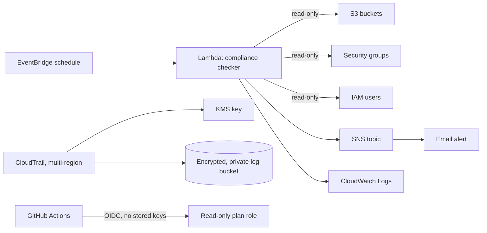

# aws-landing-zone-lite


A small Terraform project that sets up an AWS account the way a cloud team would at the start of
an engagement: audit logging, account hygiene, keyless CI access, a reusable network, and an
automated compliance check that alerts when the account drifts from good practice.

This is a learning project for a single personal account, not a production landing zone.

## Status

| Part | State |
| --- | --- |
| Compliance checker Lambda (S3, security groups, IAM MFA) with 20 tests | Done |
| Terraform baseline: CloudTrail + KMS, encrypted log bucket, password policy, budget, GitHub OIDC | Written, formatted and Checkov-clean. Deploy and add screenshots. |
| Terraform compliance-checker module: Lambda, EventBridge schedule, SNS, least-privilege role | Written, formatted and Checkov-clean. Deploy and add screenshots. |
| Network module: VPC, public and private subnets, flow logs (off by default) | Written, formatted and Checkov-clean |
| CI: tests, lint, `terraform validate`, Checkov, secret scan | Done (check the Actions tab) |
| AWS Organizations: OUs and service control policies | Planned (needs an organization management account) |
| `terraform plan` on pull requests via the OIDC role (needs remote state) | Planned |

<!-- TODO after deploying: add a screenshot of the SNS alert email and the CloudWatch log output -->

## Architecture



## What the compliance checker looks for

| Check | Severity | Flags |
| --- | --- | --- |
| `s3-public-access-block` | Medium | Bucket without all four Block Public Access settings on |
| `s3-public-policy` | High | Bucket policy that makes the bucket public |
| `security-group-open-to-internet` | High | Inbound rule open to `0.0.0.0/0` or `::/0`, except single ports 80 and 443 |
| `iam-user-without-mfa` | High | IAM user with a console password and no MFA device |

It only reads configuration. If one check fails to run (for example a missing permission), the
others still run and the failure is listed in the alert instead of being hidden.

## Repository layout

```
functions/compliance_checker/   Python code (checks.py, handler.py)
functions/tests/                pytest tests using moto to simulate AWS (no real account needed)
infra/modules/baseline/         CloudTrail, KMS, log bucket, password policy, budget, GitHub OIDC
infra/modules/compliance-checker/  Lambda, schedule, SNS, least-privilege IAM role
infra/modules/network/          VPC, subnets, routes, flow logs
infra/envs/dev/                 The environment that wires the modules together
docs/networking.md              Network design notes, including a hub-and-spoke diagram
.checkov.yaml                   Security scan config, with a reason for every skipped check
```

## Run the tests (no AWS account needed)

```bash
cd functions
python -m venv .venv && source .venv/bin/activate
pip install -r requirements-dev.txt
ruff check . && pytest -q
```

## Deploy to your own AWS account

You need Terraform 1.6 or newer, the AWS CLI configured for **a non-root identity with MFA**, and
an AWS account where you are happy to create these resources.

1. **Set a budget alert first** in the AWS console (this repo also creates one, but do not rely on it alone).
2. Copy `infra/envs/dev/terraform.tfvars.example` to `terraform.tfvars` and set your email and GitHub repository.
3. Deploy:

   ```bash
   cd infra/envs/dev
   terraform init
   terraform plan
   terraform apply
   ```

4. **Confirm the SNS subscription** from the email AWS sends, or you will not receive alerts.
5. Commit the generated `.terraform.lock.hcl` file, which pins provider versions.
6. Run the checker once without waiting for the schedule:

   ```bash
   aws lambda invoke --function-name lzlite-dev-compliance-checker --region ap-southeast-2 out.json && cat out.json
   ```

7. To see it work, create a security group that allows SSH from anywhere, run the checker again,
   check the alert email, then delete the group.

## Cost and teardown

Expect low cost, but check current AWS pricing yourself. A customer-managed KMS key is billed
monthly, and CloudTrail storage, flow logs (if you enable the network module) and Lambda usage
add small amounts. The Lambda runs once a day.

To remove everything: set `force_destroy_logs = true` in `terraform.tfvars`, run `terraform apply`
(so the log bucket can be emptied), then `terraform destroy`. KMS keys are deleted after a
waiting period (7 days here), not immediately. Check the AWS billing page the next day.

## Design decisions

- **Least privilege.** The Lambda role can only list and describe the resources it checks, publish to
  one topic, and write its own logs. Actions without resource-level support use `*`, and the
  reason is recorded in `.checkov.yaml`.
- **No long-lived keys.** GitHub Actions uses an OIDC role that trusts only this repository's main
  branch and pull requests, and the role is read-only.
- **Audit logs are protected.** Multi-region CloudTrail with log file validation, encrypted with a
  rotating KMS key, in a private versioned bucket that denies non-HTTPS access.
- **Scans run in CI and skips are explained.** Checkov runs on every change. Each skipped check has a
  written reason, because a skip is a decision and should be reviewable.
- **Tests do not touch AWS.** `moto` simulates the services, so the tests are fast and safe.

## Known limitations

- The checker inspects the account and region it runs in. Security groups in other regions are not checked.
- IAM users with access keys but no console password are not flagged for MFA.
- State is stored locally by default. For a team, use an S3 backend with locking.
- The Lambda is not in a VPC, has no dead letter queue and has no code signing. These are
  documented skips for a small demo account, not recommendations for production.
- A single account is not an AWS Organization. Service control policies and multi-account
  guardrails are on the roadmap.

## Roadmap

1. Deploy, screenshot the alert and the CloudWatch logs, and add them to this README
2. Remote state in S3, then `terraform plan` on pull requests using the OIDC role
3. AWS Organizations: OUs and service control policies (deny leaving the region, deny disabling CloudTrail)
4. CloudTrail to CloudWatch Logs, and an alarm on the Lambda's errors
5. Transit gateway hub-and-spoke example (see `docs/networking.md`)
