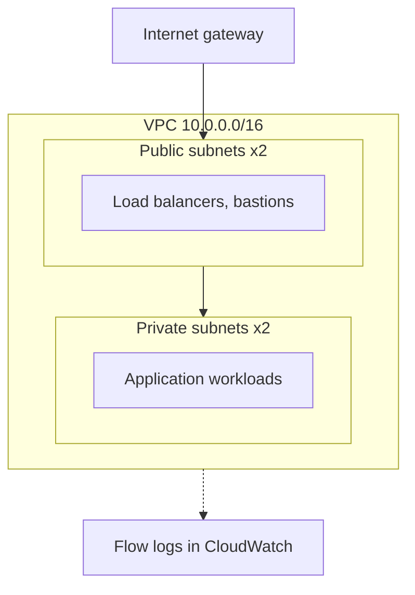
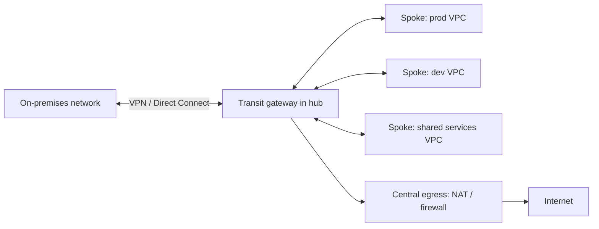

# Networking notes

## What the `network` module builds today

One VPC, two public and two private subnets across two availability zones, an internet gateway,
separate route tables, a locked-down default security group, and VPC flow logs to CloudWatch.
Private subnets have **no** internet route. A NAT gateway is billed hourly, so it is left out;
add one (or VPC endpoints for AWS services) when a workload needs outbound access.

## Hub-and-spoke: how this would grow (design pattern, not built here)

In a real landing zone each workload account gets its own VPC (a spoke). A shared network account
holds a hub with a transit gateway, central egress (NAT, firewall) and a link to on-premises
networks (VPN or Direct Connect). Spokes talk to each other and out through the hub only, so
traffic inspection and routing rules live in one place.

This repo's `network` module is the building block for a spoke. Transit gateway attachments and
the hub account are a possible next step; they are not implemented.
